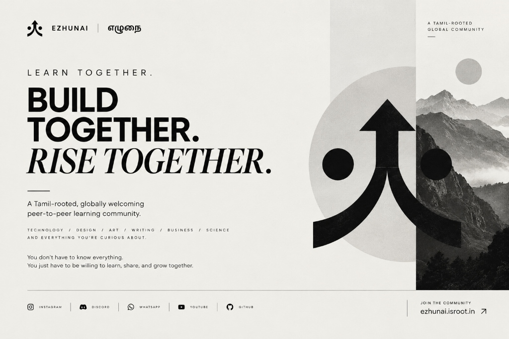

  

 

**A Tamil-rooted, globally welcoming peer-to-peer learning community.**  
*Built around the principle that everyone has something to learn, and everyone has something to share.*

---

## Overview

Ezhunai is a community initiative designed to bring curious minds together to exchange knowledge, explore interdisciplinary interests, develop practical skills, and collaborate on ideas.

The initiative does not operate as a conventional school, an academy, or a commercial course provider. Instead, it fosters an environment of equals where members participate simultaneously as learners and teachers.

While deeply rooted in Tamil cultural identity, the community maintains an open, inclusive global circle. We welcome individuals across all cultures, languages, and technical proficiencies, using English as an inclusive medium of collaboration whenever necessary.

---

## Etymology and Identity

The name **Ezhunai** reflects the synthesis of two Tamil words:

| Tamil Root | Transliteration | Translation & Significance |
| :--- | :--- | :--- |
| **எழு** | *Ezhu* | To rise, awaken, grow, or advance forward |
| **இணை** | *Inai* | To connect, unite, or come together as equals |
| **எழுநை** | **Ezhunai** | **Rise Together** |

> *\"கற்றது கைமண் அளவு, கல்லாதது உலகளவு\"*  
> *(What we have learned is like a handful of sand; what we have yet to learn is as vast as the world).*  
> This proverb serves as our guiding reminder to remain humble and curious, recognizing that knowledge expands through collective exchange.

---

## Founding Principles

1. **Mutual Learning**  
   Learning is treated as an active conversation rather than passive consumption. Everyone brings unique insights regardless of formal credentials.

2. **Curiosity Over Perfection**  
   Beginners are welcomed without hesitation. Incomplete work, raw questions, and iterative experiments are treated as valuable learning opportunities.

3. **Interdisciplinary Synergy**  
   Disciplines are not partitioned into rigid categories. Developers, designers, writers, artists, and business builders collaborate within a single unified community.

4. **Privacy and Respect**  
   Participation does not require invasive personal disclosure or tracking. Interactions center around ideas, projects, and positive peer contribution.

---

## Technical Architecture

The Ezhunai main website is engineered with a strict zero-dependency philosophy, ensuring longevity, rapid rendering, and straightforward maintenance:

- **Markup**: Pure semantic HTML5 structured for accessibility (WCAG AA compliant).
- **Styling**: Vanilla CSS3 using custom properties, high-contrast typography, and fluid clamp() layouts.
- **Client Scripting**: Vanilla ES6+ JavaScript handling mobile drawer navigation, sticky header elevations, and marquee controls.
- **Motion Accessibility**: Dedicated support for prefers-reduced-motion alongside manual pause/resume controls.
- **Machine & Agent Discovery**: Adherence to the /llm.txt standard alongside XML sitemaps and Schema.org JSON-LD structured metadata.
- **Hosting**: Served globally via GitHub Pages Anycast edge proxy with automated TLS encryption.

---

## Repository Structure

`	ext
website/
├── .github/
│   └── workflows/
│       └── ci.yml               # Automated syntax & link verification workflow
├── assets/
│   ├── ezhunai-brand-poster-dark.jpg   # Brand artwork (dark variant)
│   ├── ezhunai-brand-poster-light.jpg  # Brand artwork (light variant)
│   ├── ezhunai-hero-community.webp     # Hero photographic visual
│   ├── ezhunai-logo.jpg                # Vector mark and circular emblem
│   └── *.svg                           # Platform iconography
├── scripts/
│   ├── check-links.mjs          # Asset reference and anchor link validator
│   └── serve.mjs                # Zero-dependency local Node.js preview server
├── legacy/                      # Archival backend and Cloudflare Worker artifacts
├── 404.html                     # Animated custom error page
├── index.html                   # Main production landing page
├── style.css                    # Production stylesheet
├── app.js                       # Interactive client logic
├── CNAME                        # Apex custom domain pointer
├── .nojekyll                    # Disables Jekyll processing on GitHub Pages
├── llm.txt                      # Concise LLM community manifest
├── llms-full.txt                # Full-context LLM specification
├── robots.txt                   # Search crawler directives
├── sitemap.xml                  # Production XML sitemap
├── package.json                 # Project scripts and manifest
├── CONTRIBUTING.md              # Contributor guidelines
├── CODE_OF_CONDUCT.md           # Community behavioral standards
├── SECURITY.md                  # Vulnerability disclosure policy
└── LICENSE                      # MIT License
`

---

## Local Development

The project requires no external build tools or third-party dependencies.

### Running Locally

`ash
# Clone the repository
git clone https://github.com/Ezhunai/website.git
cd website

# Start the local development server (Node.js 18+)
npm run dev
`

Visit http://localhost:3000 in your browser.

### Verifying Code & Link Integrity

`ash
npm test
`

This verifies that all local file assets, CSS references, and in-page anchor links resolve properly.

---

## Community Channels

| Channel | URL | Purpose |
| :--- | :--- | :--- |
| **Website** | [ezhunai.isroot.in](https://ezhunai.isroot.in) | Public portal and community introduction |
| **Discord** | [discord.gg/8Pd6nUmWFy](https://discord.gg/8Pd6nUmWFy) | Daily discussions, voice sessions, and project collaboration |
| **WhatsApp** | [chat.whatsapp.com](https://chat.whatsapp.com/LVGGC3lCBJG78k4rkcPijB) | Community updates and announcements |
| **Instagram** | [@ezhunai](https://www.instagram.com/ezhunai/) | Community highlights, carousels, and visual stories |
| **YouTube** | [@Ezhunai](https://www.youtube.com/@Ezhunai) | Recorded sessions and educational deep-dives |
| **GitHub** | [github.com/Ezhunai](https://github.com/Ezhunai) | Open-source software, tools, and repositories |

---

## Contributing

Contributions from both beginners and experienced developers are welcome. Please consult [CONTRIBUTING.md](CONTRIBUTING.md) for pull request guidelines and [CODE_OF_CONDUCT.md](CODE_OF_CONDUCT.md) for community standards.

---

## Contact

- **Official Email**: [ezhunai.community@gmail.com](mailto:ezhunai.community@gmail.com)
- **Organization**: [github.com/Ezhunai](https://github.com/Ezhunai)

---

## License

This project is licensed under the [MIT License](LICENSE).